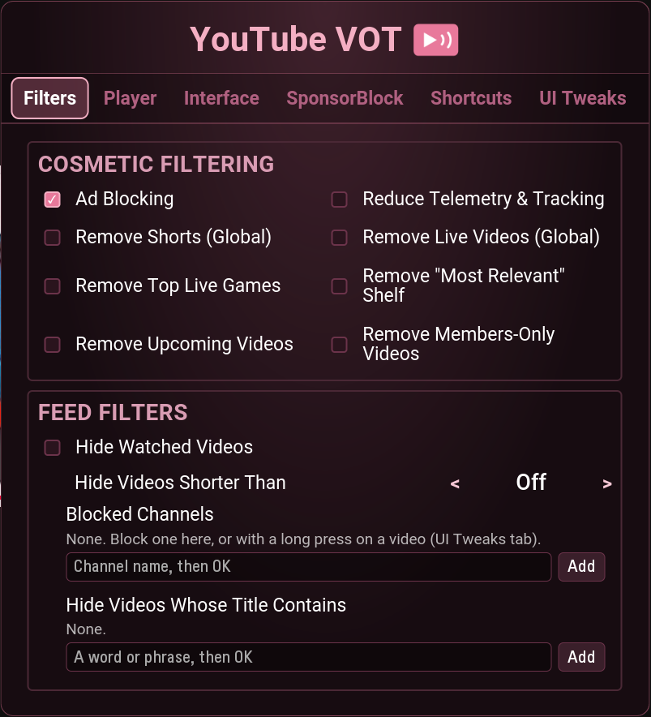
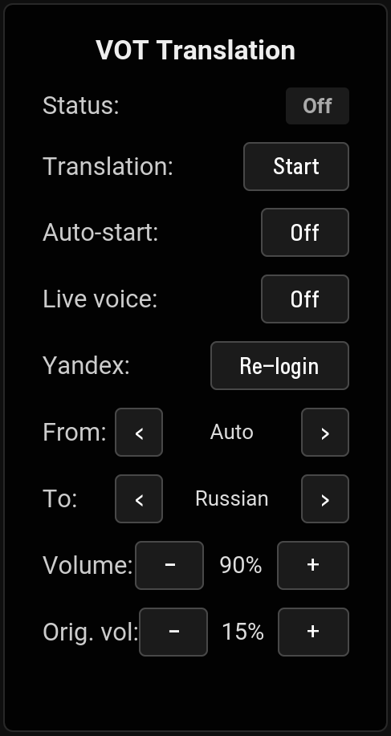

<p align="center">
  
</p>

<h1 align="center">YouTube VOT для LG webOS</h1>

<p align="center">
  YouTube без рекламы с закадровым переводом видео (Voice Over Translation) для телевизоров LG.
</p>

---

## Что умеет

- **Закадровый перевод (VOT).** Озвучка от Яндекса поверх оригинала: автоматически
  или по кнопке, перевод на русский, английский или казахский, отдельная громкость
  перевода и оригинала, «живой голос» (на русский) после входа в Яндекс-аккаунт по QR-коду.
- **Интерфейс как у оригинального VOT.** Плашка над видео на красной кнопке: статус
  перевода с обратным отсчётом, голос, субтитры и меню настроек, всё с пульта.
- **Субтитры Яндекса.** Переведённые или оригинальные субтитры поверх видео.
- **Перевод новых видео.** Если Яндекс ещё не переводил ролик, приложение само скачивает
  его аудиодорожку через плеер YouTube и отправляет на перевод — прогресс виден на плашке.
- **Без рекламы.** Реклама в видео, баннеры, промо-плитки и оверлеи с QR-кодами.
- **SponsorBlock.** Пропуск спонсорских вставок, интро, концовок и других сегментов.
- **Кнопки пульта.** Цветные кнопки и цифры назначаются на любые действия.
- **Быстрее на старых ТВ.** Отдельная сборка для webOS 3–6; на webOS 5 и старше
  YouTube работает в своём облегчённом режиме, лишние фоновые процессы отключены.
- **Как настоящий YouTube.** ID приложения — `youtube.leanback.v4`: кнопка YouTube на
  пульте, трансляция с телефона и голосовой поиск открывают именно его.

<p align="center">
  
  &nbsp;
  
</p>
<p align="center"><sub>Настройки (зелёная кнопка) и перевод с субтитрами (красная кнопка)</sub></p>

## Установка

Нужен ТВ LG с webOS 3 или новее и [Homebrew Channel](https://github.com/webosbrew/webos-homebrew-channel).

> Перед установкой удалите другие YouTube-приложения (официальное или модификации).
> Все они хранят данные youtube.com в одном месте, и удаление любого из них стирает
> вход в аккаунт и настройки у остальных.

**Через Homebrew Channel (с обновлениями по воздуху):** Settings → Add repository →

```
https://tinyurl.com/ytvot-tv
```

или полная ссылка:

```
https://raw.githubusercontent.com/DjVreditel/youtube-webos-vot/main/repo.json
```

Приложение появится в каталоге Homebrew Channel, новые версии придут как обновление.

**Вручную:** скачайте `.ipk` со страницы [Releases](https://github.com/DjVreditel/youtube-webos-vot/releases)
и установите через [webOS Dev Manager](https://github.com/webosbrew/dev-manager-desktop) или
`ares-install youtube.leanback.v4_<версия>_all.ipk`.

### Какую версию выбрать

В каталоге три приложения:

| | Обычная | Cobalt | Cobalt (отдельно) |
|---|---|---|---|
| Движок | браузер телевизора | Cobalt, как в официальном YouTube для ТВ | Cobalt |
| Скорость интерфейса | как у обычного YouTube на старых ТВ | заметно быстрее | заметно быстрее |
| Звук видео | чистый | на некоторых видео (особенно музыка) слегка подёргивается | так же |
| Где появляется | вместо YouTube | вместо YouTube (заменяет обычную версию) | отдельной иконкой рядом с YouTube |
| Кнопка YouTube на пульте | открывает её | открывает её | открывает обычную версию |
| Вход в аккаунты | свой | свой (заново) | свой (заново) |
| Файл | `youtube.leanback.v4_<версия>_all.ipk` | `youtube.leanback.v4_<версия>_arm.ipk` | `youtube.vot.cobalt_<версия>_arm.ipk` |

Если сомневаетесь — ставьте обычную. Cobalt-версии экспериментальные и проверены только на
webOS 4. Чтобы вернуться с Cobalt на обычную, просто установите «YouTube VOT» из каталога.

## Управление

| Кнопка   | Действие                                  |
| -------- | ----------------------------------------- |
| 🟥 Красная | Плашка перевода VOT: ←→ кнопки, ↓ меню, OK |
| 🟩 Зелёная | Настройки приложения                       |
| 🟦 Синяя   | SponsorBlock: пропуск / переход к хайлайту |

Все кнопки переназначаются: Настройки → Shortcuts.

## Сборка из исходников

```bash
git clone https://github.com/DjVreditel/youtube-webos-vot.git
cd youtube-webos-vot/vot-mod
npm run package        # готовый .ipk появится в dist/
```

Подробности о сборке, патчере и выпуске версий — в [vot-mod/README.md](vot-mod/README.md).

## Лицензия

GPL-3.0. Основано на открытых проектах youtube-webos (webosbrew и его форки).
