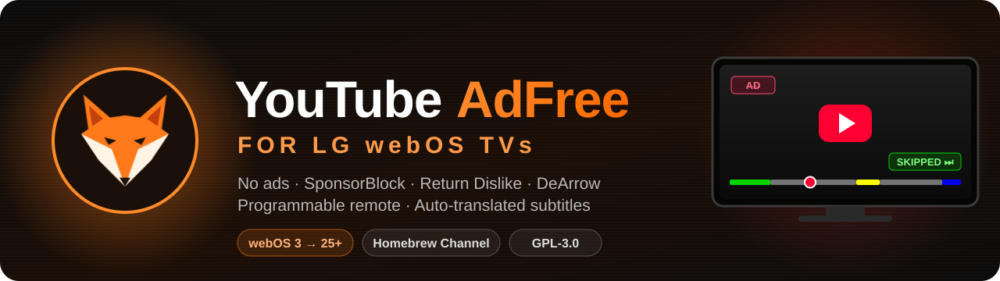
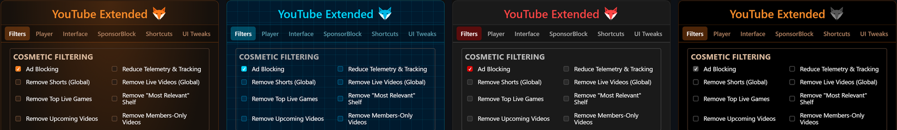
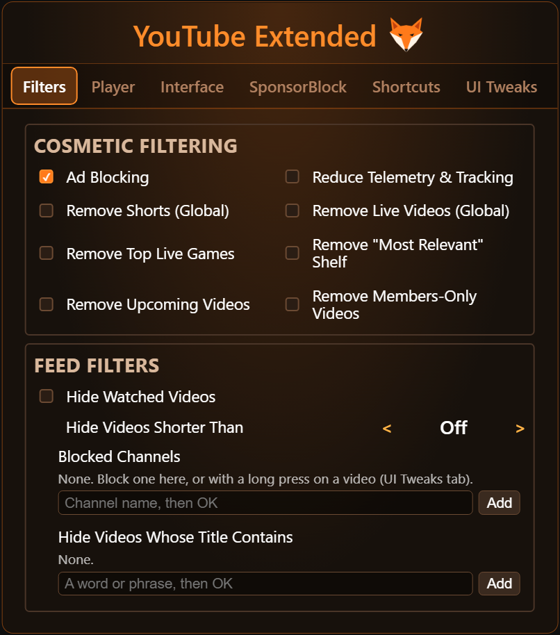
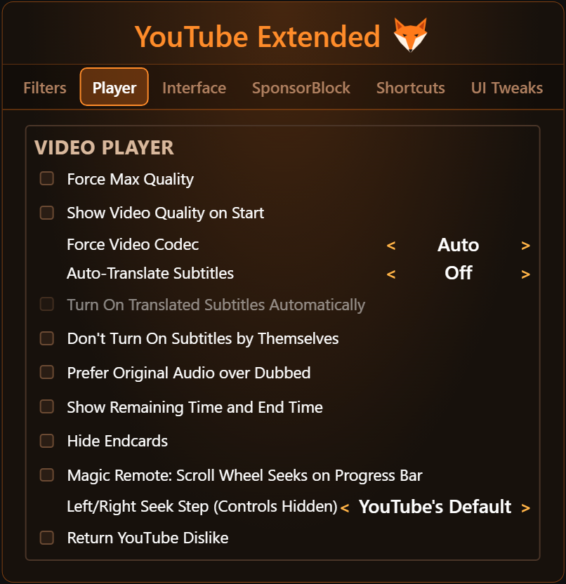
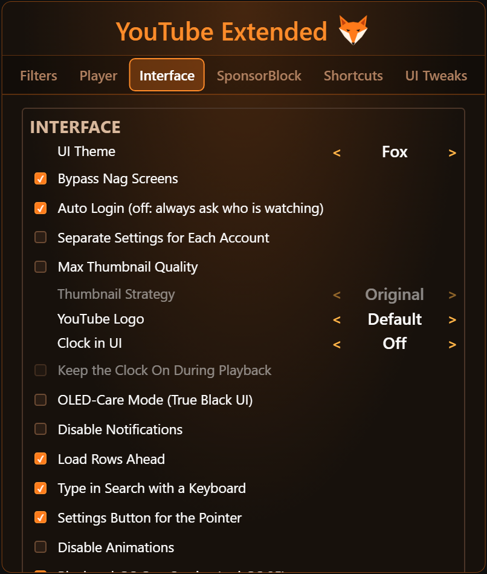
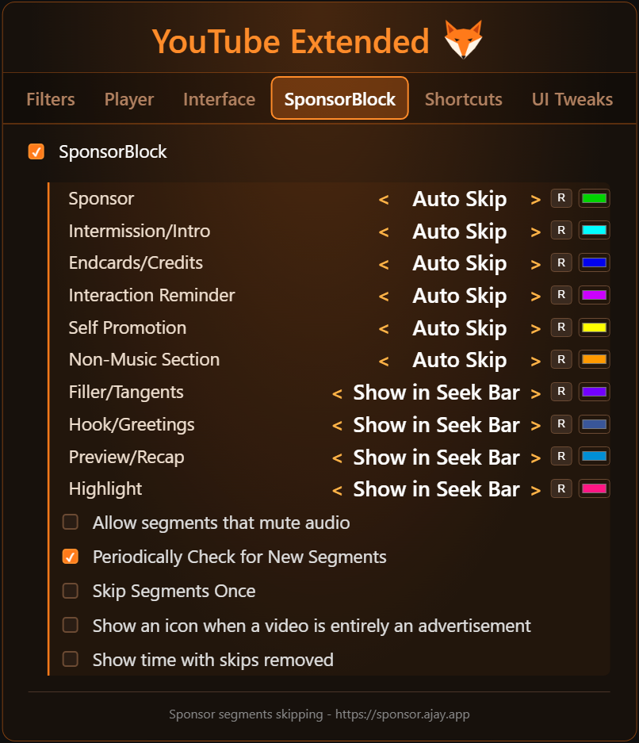
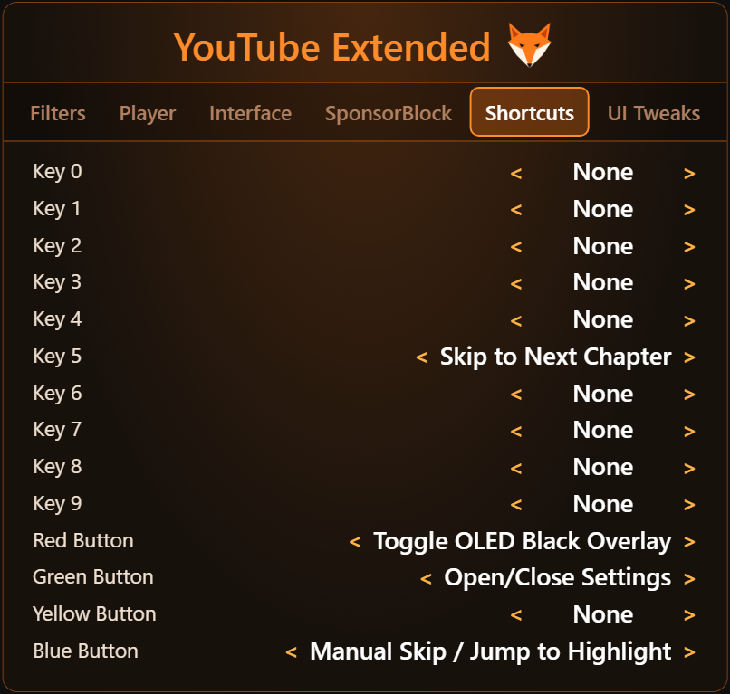
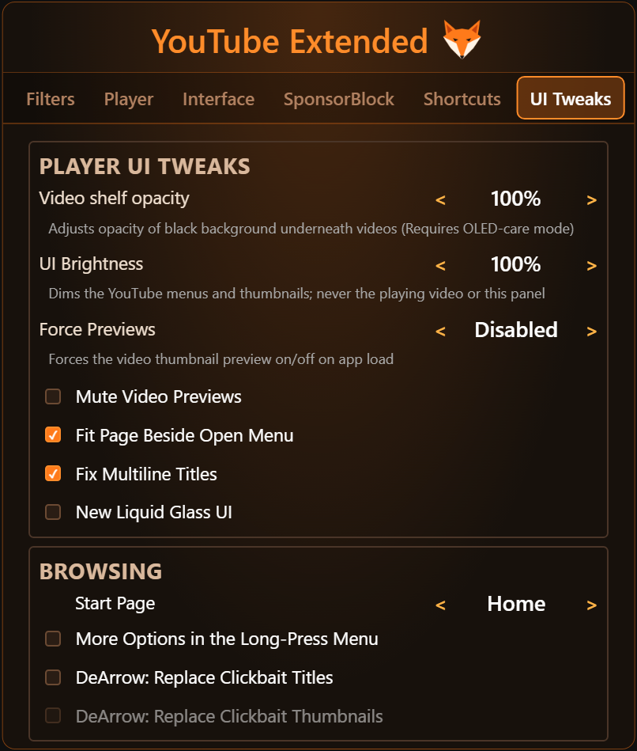

<p align="center">
  
</p>

<p align="center">
  <a href="https://github.com/foxi69/youtube-webos/releases/latest"></a>
  <a href="https://github.com/foxi69/youtube-webos/releases"></a>
  
  <a href="LICENSE"></a>
  <a href="https://github.com/foxi69/youtube-webos/stargazers"></a>
</p>

<p align="center">
  <b>Ad-free YouTube for LG TVs</b>, with SponsorBlock, Return YouTube Dislike, DeArrow, a programmable remote and dozens of fixes.<br>
  Built on <a href="https://github.com/NicholasBly/youtube-webos">NicholasBly/youtube-webos</a>, plus the best of every other fork of the project.
</p>

<p align="center">
  <a href="#-installation"><b>Install</b></a> ·
  <a href="#-highlights"><b>Highlights</b></a> ·
  <a href="#-remote-control"><b>Remote</b></a> ·
  <a href="#%EF%B8%8F-settings"><b>Settings</b></a> ·
  <a href="#-what-this-fork-adds"><b>What's new</b></a> ·
  <a href="#-building"><b>Build</b></a>
</p>

---

## ✨ Highlights

<table>
  <tr>
    <td width="33%" valign="top">
      <h3>🚫 No ads</h3>
      A schema-based filter engine cleans Home, Search and Shorts, and drops QR-code, shop and "paid promotion" overlays during playback.
    </td>
    <td width="33%" valign="top">
      <h3>⏭️ SponsorBlock</h3>
      Every segment type, with its own colour on the seek bar. Auto, manual or seek-bar-only per category, and new segments are picked up while you watch.
    </td>
    <td width="33%" valign="top">
      <h3>🎮 Your remote, your rules</h3>
      All four colour buttons and 0-9 can run any action: Sleep Timer, Audio-Only, Jump to Live, chapters, subtitles and more. Magic Remote wheel seeks.
    </td>
  </tr>
  <tr>
    <td valign="top">
      <h3>🌍 Any subtitle language</h3>
      Auto-translated subtitles in about 30 languages, Hungarian included, where the TV app normally offers 16. Original audio in place of dubbed tracks.
    </td>
    <td valign="top">
      <h3>🖤 OLED care</h3>
      A black overlay on 🟥 Red while the audio plays, a true-black UI, Audio-Only Mode and adjustable UI brightness.
    </td>
    <td valign="top">
      <h3>🧹 A cleaner feed</h3>
      Hide watched videos, videos shorter than a set length, blocked channels, title keywords, Shorts, live and members-only videos. DeArrow replaces clickbait titles and thumbnails.
    </td>
  </tr>
</table>

<p align="center">
  
  <br><sub>Three panel themes (<b>Fox</b>, <b>Blue</b>, <b>Red</b>), and any of them in true black with OLED-Care Mode.</sub>
</p>

## 📦 Installation

> [!IMPORTANT]
> Uninstall the official YouTube app first.

**1. Pick the package for your TV** from the [**Releases**](https://github.com/foxi69/youtube-webos/releases/latest) page:

| File | TVs |
|---|---|
| `youtube.leanback.v4_<version>_all_webOS22+.ipk` | **webOS 22 and newer** (2022+ TVs). Lighter and faster; use this when your TV supports it. |
| `youtube.leanback.v4_<version>_all.ipk` | **webOS 3-6** (2016-2021 TVs). Also runs on newer TVs. |

**2. Install it** in one of three ways:

- 🍺 **[webOS Homebrew Channel](https://github.com/webosbrew/webos-homebrew-channel)** (recommended, updates come by themselves): add the repo link for your TV.

  | TVs | Repo link |
  |---|---|
  | webOS 22 and newer | `https://raw.githubusercontent.com/foxi69/youtube-webos/main/repo-webos22.json` |
  | webOS 3-6 (or any TV) | `https://raw.githubusercontent.com/foxi69/youtube-webos/main/repo.json` |

  Add only one of them: both builds install as the same app, and Homebrew Channel offers the update from the link
  you added. NicholasBly's repo link would replace this build with NicholasBly's.
- 💻 **[Device Manager app](https://github.com/webosbrew/dev-manager-desktop)**: install the downloaded `.ipk`.
- ⌨️ **[webOS TV CLI tools](https://webostv.developer.lge.com/develop/tools/cli-installation)**:
  `ares-install youtube...ipk` (see [Development TV setup](#development-tv-setup)).

## 🎮 Remote control

| Button | Default | Notes |
|---|---|---|
| 🟩 Green | Open/close the settings | If no button is set to *Open/Close Settings*, Green is forced back to it. |
| 🟥 Red | OLED black overlay | Blacks out the screen while audio plays. Notifications stay visible and the clock is hidden. |
| 🟨 Yellow | *None* (YouTube's own search) | Can be set to any action, see below. While it is *None*, YouTube's search binding keeps working. |
| 🟦 Blue | SponsorBlock manual skip / jump to highlight | |
| 5 | Skip to next chapter | |
| 0-4, 6-9 | *None* | Can be set to any action during playback. |
| Back | Closes the settings panel | Otherwise YouTube's normal Back. Holding it to close the panel does not also go back a page. |
| Left / Right | YouTube's own | With *Left/Right Seek Step* set, they seek by that step while the player controls are hidden. |
| Hold OK on a video | YouTube's menu | With *More Options in the Long-Press Menu* on, it also offers "Block channel", "Not interested" and "Don't recommend channel". |
| Magic Remote wheel | Scrolls | With *Scroll Wheel Seeks* on, each notch on the focused progress bar seeks 10 s. |
| Magic Remote pointer | Shows a 🦊 button | Moving the pointer shows a fox button in the top-right corner that opens and closes the settings, for remotes without colour buttons. |

Every coloured button and number key can be set to any of these actions on the **Shortcuts** tab:

- **Playback:** Play/Pause, Fast Forward (Burst), Rewind (Burst), Skip to Next / Previous Chapter,
  **Jump to Live** (back to the live edge of a live stream)
- **SponsorBlock:** Manual Skip / Jump to Highlight, Skip to Last SponsorBlock Segment
- **Panels:** Toggle Subtitles, Toggle Comments, Toggle Description, Save / Watch Later
- **Screen:** Toggle OLED Black Overlay, **Toggle Audio-Only Mode** (hides the picture and keeps the sound; ends
  when you leave the video), **Sleep Timer** (each press steps 15/30/60/90/120 min, then off; pauses the video
  when it runs out)
- **App:** Open/Close Settings, Refresh Page

Holding a key that runs a seek keeps seeking; holding any other bound key runs it once and is not passed on
to YouTube. A USB or Bluetooth keyboard can type in the search page (see *Type in Search with a Keyboard*).

## ⚙️ Settings

Open the panel with 🟩 **Green**, or with the 🦊 button the Magic Remote pointer shows. It has six tabs; pick a
theme with **UI Theme** on the Interface tab, or click the fox in the panel header. Defaults are in the right-hand
column. A setting marked *webOS 25* or *guest* only appears there.

<details>
<summary><b>🚫 Filters</b>: ad blocking and what the feeds show</summary>
<br>
<p align="center"></p>

| Setting | Default |
|---|---|
| Ad Blocking | On |
| Reduce Telemetry & Tracking | Off |
| Remove Shorts (Global) | Off |
| Remove Live Videos (Global) | Off |
| Remove Top Live Games | Off |
| Remove "Most Relevant" Shelf | Off |
| Remove Upcoming Videos | Off |
| Remove Members-Only Videos | Off |
| Guest Mode: Hide Sign-in Buttons (*guest*) | Off |
| Hide Watched Videos (90%+; not in History, Library, playlists) | Off |
| Hide Videos Shorter Than (1, 2, 3, 5, 10, 20 min) | Off |
| Blocked Channels | Empty |
| Hide Videos Whose Title Contains | Empty |

All filters except Ad Blocking need Ad Blocking on. The two lists are edited with a text box: type with the TV's
keyboard (OK on the box) or a USB/Bluetooth one, then OK; select an entry to remove it.
</details>

<details>
<summary><b>▶️ Player</b>: quality, codec, subtitles, audio, seeking</summary>
<br>
<p align="center"></p>

| Setting | Default |
|---|---|
| Force Max Quality | Off |
| Show Video Quality on Start | Off |
| Force Video Codec (Auto, AV1, VP9, AVC, HEVC, Avoid AV1) | Auto |
| Auto-Translate Subtitles (pick a language) | Off |
| Turn On Translated Subtitles Automatically | Off |
| Don't Turn On Subtitles by Themselves | Off |
| Prefer Original Audio over Dubbed | Off |
| Show Remaining Time and End Time | Off |
| Hide Endcards | Off |
| Magic Remote: Scroll Wheel Seeks on Progress Bar | Off |
| Left/Right Seek Step (5, 10, 15, 30, 60 s) | YouTube's default |
| Return YouTube Dislike | Off |

**Auto-Translate Subtitles** offers about 30 languages: Hungarian, English, German, Spanish, French, Italian,
Portuguese, Dutch, Polish, Czech, Slovak, Romanian, Croatian, Serbian, Slovenian, Bulgarian, Greek, Turkish,
Ukrainian, Russian, Swedish, Danish, Finnish, Norwegian, Arabic, Hindi, Indonesian, Vietnamese, Thai, Japanese,
Korean and Chinese. The chosen language is pinned to the top of the subtitle menu; if the video has no subtitle in
it, a "*Language* (auto-translated)" track is added, translated by YouTube's own servers.

Return YouTube Dislike sends the id of every video you open to returnyoutubedislikeapi.com.
</details>

<details>
<summary><b>🖥️ Interface</b>: theme, login, thumbnails, clock</summary>
<br>
<p align="center"></p>

| Setting | Default |
|---|---|
| UI Theme (Fox, Blue, Red) | Fox |
| Bypass Nag Screens (also "Are you still watching?") | On |
| Auto Login (off: always ask who is watching) | On |
| Separate Settings for Each Account | Off |
| Max Thumbnail Quality | Off |
| Thumbnail Strategy (Original, Fast, Smooth (SD)) | Original |
| YouTube Logo (Default, Premium, Hidden) | Default |
| Clock in UI (Off, Time, Date and Time) | Off |
| Keep the Clock On During Playback | Off |
| OLED-Care Mode (True Black UI) | Off |
| Disable Notifications | Off |
| Load Rows Ahead | On |
| Type in Search with a Keyboard | On |
| Settings Button for the Pointer | On |
| Disable Animations | Off |
| Block webOS Cast Service (*webOS 25*) | On |
</details>

<details>
<summary><b>⏭️ SponsorBlock</b>: what to skip, and how</summary>
<br>
<p align="center"></p>

| Setting | Default |
|---|---|
| SponsorBlock | On |
| Sponsor, Intro, Outro, Interaction Reminder, Self Promotion, Non-Music Section | Auto Skip |
| Preview/Recap, Filler/Tangents, Hook/Greetings | Show in Seek Bar |
| Highlight (Auto Skip to Start, Ask, Show in Seek Bar, Disable) | Show in Seek Bar |
| Allow segments that mute audio | Off |
| Periodically Check for New Segments | On |
| Skip Segments Once | Off |
| Show an icon when a video is entirely an advertisement | Off |
| Show time with skips removed | Off |

Each category can be set to Auto Skip, Manual Skip, Show in Seek Bar or Disable, and has its own colour.
</details>

<details>
<summary><b>🎮 Shortcuts</b>: what each button does</summary>
<br>
<p align="center"></p>

| Key | Default |
|---|---|
| 🟥 Red | Toggle OLED Black Overlay |
| 🟩 Green | Open/Close Settings |
| 🟨 Yellow | None (YouTube's search) |
| 🟦 Blue | Manual Skip / Jump to Highlight |
| 5 | Skip to Next Chapter |
| 0-4, 6-9 | None |

The actions each key can take are listed under [Remote control](#-remote-control).
</details>

<details>
<summary><b>🎨 UI Tweaks</b>: previews, menu, start page, DeArrow</summary>
<br>
<p align="center"></p>

| Setting | Default |
|---|---|
| Video shelf opacity (needs OLED-Care Mode) | 100% |
| UI Brightness (dims menus and thumbnails, never the video) | 100% |
| Previews With Sound (Disabled, Force On, Force Off; sets YouTube's own setting) | Disabled |
| Mute Video Previews | Off |
| Fit Page Beside Open Menu | Off |
| Fix Multiline Titles | On |
| New Liquid Glass UI | Off |
| Emoji + Characters Fix (webOS 3-4 only) | On |
| Start Page (Home, Subscriptions, Library, History) | Home |
| More Options in the Long-Press Menu | Off |
| DeArrow: Replace Clickbait Titles | Off |
| DeArrow: Replace Clickbait Thumbnails | Off |

**Fit Page Beside Open Menu**: while the left menu is open, YouTube slides the page right and its right side leaves
the screen; with this option the page shrinks to fit beside the menu instead. DeArrow asks dearrow.ajay.app by hash
prefix, like SponsorBlock. The Start Page is not used on a launch into a video.
</details>

## 🆕 What this fork adds

Compared to upstream NicholasBly 0.8.4. Taken from webosbrew, NicholasBly's open pull requests and the other forks
of the project; credits are in [CHANGELOG.md](CHANGELOG.md).

**New**
- Auto-Translate Subtitles to a language of your choice.
- Auto Login: always ask who is watching.
- Separate Settings for Each Account: each YouTube account on the TV keeps its own settings.
- Bindable yellow button, Sleep Timer and Audio-Only Mode.
- Magic Remote scroll-wheel seeking.
- SponsorBlock picks up segments submitted while you watch: re-checked during playback.
- Block webOS Cast Service toggle.
- *0.8.6:* Remove Upcoming / Members-Only Videos filters, Load Rows Ahead, Smooth (SD) thumbnails, Turn On
  Translated Subtitles Automatically, typing in search with a USB/Bluetooth keyboard, Jump to Live, Show Video
  Quality on Start, a pointer button for the settings, Disable Animations and UI Brightness.
- *0.8.7:* no "Are you still watching?" pause, no paid-promotion banner, a clock with the date that can stay on
  during playback, remaining time and end time, Mute Video Previews and Don't Turn On Subtitles by Themselves;
  about 5.6 KB smaller packages.
- *0.8.8:* from MickLesk's fork, Prefer Original Audio over Dubbed, Feed Filters (watched videos, short
  videos, blocked channels, title keywords), "Block channel" / "Not interested" / "Don't recommend channel" in the
  long-press menu, Start Page, a Left/Right seek step and DeArrow; from Dazzyelv's fork, Fit Page Beside Open Menu.

<details>
<summary><b>Fixed</b></summary>

- Ad blocking holds up against YouTube's "property locker"; previously playback could stall a few seconds in.
- webOS 25: the webOS Cast service is no longer blocked when a cast starts the app. Casting can still fail while
  the app is open; see *Known issues* in [CHANGELOG.md](CHANGELOG.md).
- SponsorBlock: Non-Music segments are actually fetched; muted segments now mute; failed requests are retried.
- Back closes the settings panel, and colour-button seeks no longer fire twice.
- The OLED overlay no longer hides the notifications.
- Return YouTube Dislike no longer shows "1000k".
- Force Max Quality no longer expires after a year, and resets when switched off.
- 2026+ TVs are no longer detected as a simulator.
- Fixes for the legacy build (webOS 3-6).
- *0.8.6:* about 40 more, most of them from mirijanristic's fork:
  - SponsorBlock: overlapping and nested segments, a stalled server blocking the fallback, segments cut short
    by an early video length, the start-of-video chain, a late player, progress-bar watchers;
  - Ad Blocking: continuations and action lists beside the main content, bare search results, expanded
    shelves, filters that ran with Ad Blocking off;
  - thumbnails stuck at low quality after a network error, held keys, burst seeks, Shorts hiding the
    controls, the screensaver fix, Force Max Quality switched off from the home screen;
  - the settings panel: the SponsorBlock switch could not be reached with the arrows; it is about 16 KiB
    lighter without the spatial-navigation polyfill;
  - webOS 3/4: focus highlight, emoji sequences; webOS 22+: "fancy font" channel names.
</details>

<details>
<summary><b>All features</b></summary>

- Support for webOS 3, 4, 5, 6, 22, 23, 24, 25 and newer (2016 and newer LG TVs; webOS 1 and 2 are not supported).
- Ad blocking with a schema-based filter engine: cleaner Home, Search and Shorts. It also hides QR-code and
  shop overlays and the "Includes paid promotion" banner during playback.
- Optional filters: Shorts, live videos, "Most Relevant" shelf, Top Live Games, guest sign-in prompts, watched
  videos, videos shorter than a set length, blocked channels and title keywords.
- [SponsorBlock](https://sponsor.ajay.app/): every segment type, including Hook, Filler and muted segments, plus
  Highlight; a colour for every segment and a desktop-style segment list; auto, manual and seek-bar-only modes per
  category, and Skip Segments Once; full-video label and time with skips removed; new segments picked up during
  playback.
- Return YouTube Dislike in the description panel (off by default).
- [DeArrow](https://dearrow.ajay.app/) community titles and thumbnails in place of clickbait (off by default).
- Force Max Quality, Force Video Codec and Max Thumbnail Quality.
- Auto-Translate Subtitles, and the original audio in place of dubbed tracks.
- Bypass Nag Screens: account picker, Premium and other upsell screens, and "Are you still watching?".
  Optionally, always ask who is watching.
- Programmable remote: 0-9 and all four colour buttons, Magic Remote wheel seeking, a Left/Right seek step,
  more entries in the long-press menu of a video.
- Start Page: open on Subscriptions, the Library or the History.
- OLED care: black overlay on Red with keep-alive, OLED-Care Mode (true-black UI), Audio-Only Mode, Sleep Timer.
- Smart clock (time, or date and time) that hides in fullscreen and when the description panel is open, or
  stays on during playback.
- Remaining time and end time beside the video's duration.
- UI fixes: full description panel navigation, multiline titles, video shelf opacity, the page fitted beside the
  open menu, Fox, Blue and Red panel themes, YouTube logo style, emoji fix for webOS 3-4.
</details>

## 🌳 Where this fork comes from

```
FriedChickenButt/youtube-webos       the original project (inactive since 2024)
  └─ webosbrew/youtube-webos           the community-maintained continuation
       └─ NicholasBly/youtube-webos      rewritten, many features      ← this fork's upstream
            └─ foxi69/youtube-webos        this fork: upstream + the changes above
```

NicholasBly's changes are merged in regularly, and everything this fork adds stays on top of them. Work further
up the chain and on every other fork is reported by the daily [fork watch](#new-work-on-other-forks).
NicholasBly rewrote the codebase, so that work has to be ported rather than merged.

## 🚀 Autostart

To start the app automatically, run this via SSH or Telnet:

```sh
luna-send-pub -n 1 'luna://com.webos.service.eim/addDevice' '{"appId":"youtube.leanback.v4","pigImage":"","mvpdIcon":""}'
```

"YouTube" then appears as an input next to HDMI and Live TV. If it was the last selected input, it starts when the
TV is turned on. It also starts much faster, because it keeps running in the background; the cost is somewhat
higher idle memory use, which is barely noticeable in practice.

To turn autostart off:

```sh
luna-send-pub -n 1 'luna://com.webos.service.eim/deleteDevice' '{"appId":"youtube.leanback.v4"}'
```

## 🔨 Building

```sh
git clone https://github.com/foxi69/youtube-webos.git
cd youtube-webos
npm install                                  # again only when package.json changes

npm run build && npm run package             # legacy build (webOS 3 and newer)
npm run build:modern && npm run package      # webOS 22+ build (lighter)
```

Both commands create `dist/youtube.leanback.v4_<version>_all.ipk`. Rename the webOS 22+ one to
`..._all_webOS22+.ipk` if you keep both. On Windows, `build-local.cmd` and `build-local modern.cmd` do all of it.

<details>
<summary id="development-tv-setup"><b>Development TV setup</b></summary>

These instructions use the [webOS CLI tools](https://github.com/webos-tools/cli). See
<https://webostv.developer.lge.com/develop/tools/cli-introduction> for more information.

**With the Developer Mode app** (partially based on
<https://webostv.developer.lge.com/develop/getting-started/developer-mode-app>):

- Install the Developer Mode app from the Content Store and enable Developer Mode.
- Enable the key server and download the TV's private key: `http://TV_IP:9991/webos_rsa`.
  Save the key under `~/.ssh` (or `%USERPROFILE%\.ssh` on Windows).
- Configure the device with `ares-setup-device` (replace `-a` with `-m` if a device named `webos` is already
  configured). `PASSPHRASE` is the 6-character passphrase shown in the Developer Mode app; the `privatekey` path
  is relative to `~/.ssh`.

```sh
ares-setup-device -a webos -i "username=prisoner" -i "privatekey=webos_rsa" -i "passphrase=PASSPHRASE" -i "host=TV_IP" -i "port=9922"
```

**With Homebrew Channel / root:**

- Enable SSH in the Homebrew Channel app.
- Generate an SSH key on the development machine (`ssh-keygen -t rsa`) and copy the private key (`id_rsa`) to
  `~/.ssh` (or `%USERPROFILE%\.ssh` on Windows).
- Append the public key (`id_rsa.pub`) to `/home/root/.ssh/authorized_keys` on the TV.
- Configure the device with `ares-setup-device`; the `privatekey` path is relative to `~/.ssh`.

```sh
ares-setup-device -a webos -i "username=root" -i "privatekey=id_rsa" -i "passphrase=SSH_KEY_PASSPHRASE" -i "host=TV_IP" -i "port=22"
```

**Deploying and launching:**

```sh
npm run deploy    # install the built package on the configured TV
npm run launch    # start it
npm run launch -- -p '{"contentTarget":"v=F8PGWLvn1mQ"}'   # start straight into a video
```
</details>

<details>
<summary><b>For maintainers: releases, upstream sync, fork watch</b></summary>

### Releases

Releases are drafted automatically and published only after a test on the TV:

1. Every push to `main` runs [Draft release](.github/workflows/release.yml). It builds both `.ipk` files and puts
   them in a **draft** release `v<version>` (version from `package.json`), with
   [`.github/release-notes.md`](.github/release-notes.md) and that version's CHANGELOG section as release notes.
   Drafts are visible only to the repository's owner and collaborators.
2. Download the `.ipk` from the draft on the [Releases](https://github.com/foxi69/youtube-webos/releases) page and
   install it on the TV.
3. If it works, open the draft and press **Publish release**. That creates the tag and runs
   [Update Homebrew Repository](.github/workflows/build_repo.yml), which points `repo.json` (legacy) and
   `repo-webos22.json` (webOS 22+) at the new release, so Homebrew Channel offers the update.

More pushes with the same version refresh the same draft; drafts of other versions are deleted.

**Version rule:** the version in `package.json` is raised only after the previous version has been tested and
published. Until then every change goes into the current version and its draft.

### Staying up to date with upstream

The [Sync upstream](.github/workflows/sync-upstream.yml) workflow runs every day, or on demand from
**Actions → Sync upstream → Run workflow**. When NicholasBly has new commits, it merges them into the
`upstream-sync` branch and opens a pull request into `main`; your own changes are never overwritten. If the merge
has conflicts, the run fails and lists the conflicting files; then sync by hand:

```sh
git remote add upstream https://github.com/NicholasBly/youtube-webos.git   # once
git fetch upstream
git checkout main
git merge upstream/main        # resolve any conflicts, then commit
npm ci && npm run build:modern && npm run package   # rebuild and test
git push origin main
```

One-time setup on GitHub: enable workflows on the **Actions** tab (they are off by default on forks), and under
**Settings → Actions → General → Workflow permissions** tick *Allow GitHub Actions to create and approve pull
requests*.

### New work on other forks

The [Fork watch](.github/workflows/fork-watch.yml) workflow runs every day. It checks the whole fork tree of
FriedChickenButt, webosbrew and NicholasBly (forks of forks included) and the pull requests on those three
repositories. When it finds new work, it opens an issue labelled `fork-watch` with links to it. These are only
suggestions: nothing is merged. It leaves out commits NicholasBly already has, bot commits, private forks and
copies uploaded as new repositories.
</details>

## 🙏 Credits

- [FriedChickenButt](https://github.com/FriedChickenButt/youtube-webos), the original project.
- [webosbrew](https://github.com/webosbrew/youtube-webos), the community continuation.
- [NicholasBly](https://github.com/NicholasBly/youtube-webos), the rewrite this fork builds on.
- The authors of the forks whose fixes and features are ported here, credited per change in
  [CHANGELOG.md](CHANGELOG.md).

<p align="center"><sub>Made with 🦊 for LG TVs · <a href="LICENSE">GPL-3.0</a></sub></p>
